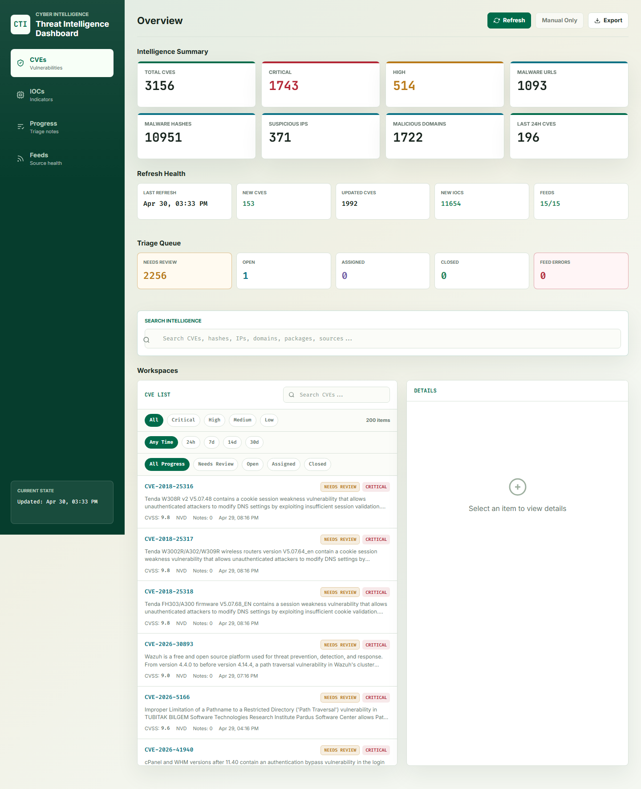

# CTI Dashboard

Local cyber threat intelligence dashboard for CVEs, IOC feeds, feed health, and lightweight CVE triage notes.

## Preview

<p>
  
</p>

## Main Features

- **Intelligence summary:** high-level CVE and IOC counts, critical/high CVE totals, last-24-hour CVEs, refresh health, feed status, and triage queue counts.
- **CVE workspace:** searchable CVE list with severity, time range, progress, company-impact filters, CVSS details, source links, notes, and CSV export.
- **IOC workspace:** searchable indicators across URLs, hashes, IPs, and domains from supported threat feeds, with source metadata and export support.
- **Progress tracking:** tag CVEs as `Open`, `Assigned`, or `Closed`, add analyst notes, and import CVEs from pasted text or CSV.
- **Company asset prioritization:** record services and applications your organization uses, import assets from CSV, match CVEs by CPE/package/alias metadata, and prioritize likely company-impacting vulnerabilities.
- **Feed health view:** see which feeds succeeded, failed, or were skipped because optional keys are missing.
- **Optional notifications:** send progress updates to Microsoft Teams and high/critical CVE alerts through Twilio WhatsApp when explicitly configured.

## Requirements

- Node.js 18 or newer
- Windows users can use `start-dashboard.cmd`; it falls back to the bundled Codex Node runtime when `node` is not on `PATH`

## Setup

```powershell
npm install
copy .env.example .env
start-dashboard.cmd
```

Then open `http://localhost:3000`.

The dashboard stores its local SQLite-compatible `sql.js` database at `data/cti.db` by default. Set `CTI_DB_PATH` to use a different file, especially for testing or disposable runs.

## Configuration

All feed keys are optional. Public NVD, CISA KEV, and GitHub advisory feeds work without paid keys, though API limits may apply. Keyed feeds currently supported by the dashboard include VulnCheck, Shodan, AbuseIPDB, OTX, GreyNoise, Censys, VirusTotal, ThreatFox, URLhaus, and MalwareBazaar.

Useful local controls:

- `PORT=3000` changes the local server port.
- `CTI_DB_PATH=` points the app at a different database file.
- `CTI_ENABLE_SCHEDULER=true` opts into background cron jobs. Leave it unset or `false` for manual-only feed refresh.
- `CTI_CORS_ORIGINS=` sets comma-separated exact browser origins if you host the UI separately. By default, cross-origin API access is limited to local browser origins.

Optional feed keys and queries live in `.env.example`. For the keyed feeds requested most often, set `VULNCHECK_API_TOKEN`, `SHODAN_API_KEY`, `ABUSEIPDB_API_KEY`, and `OTX_API_KEY`; missing optional keyed feeds are shown as skipped, not as fatal dashboard failures.

## Security And Privacy Notes

- Keep `.env`, `data/`, local database files, logs, and browser QA profiles out of git. The included `.gitignore` covers these local artifacts.
- The repository includes example screenshots generated from public CVE/IOC feed data; no feed keys, webhook URLs, or local database files are required to view them.
- The dashboard is designed for local or trusted-network use. It does not include user authentication, so do not expose it directly to the public internet without adding auth, TLS, and deployment-specific access controls.
- Optional refresh overrides, Teams webhooks, Twilio credentials, and feed API tokens should be treated as secrets. Rotate any token that is ever pasted into a public issue, screenshot, log, or commit.

## Microsoft Teams Webhooks

Progress actions can notify Microsoft Teams when enabled. Set `TEAMS_ALERTS_ENABLED=true` and paste a Teams Workflows webhook URL or compatible incoming webhook URL into `TEAMS_WEBHOOK_URL`.

- `TEAMS_WEBHOOK_FORMAT=adaptive_card` sends the Teams incoming-webhook Adaptive Card payload.
- `TEAMS_WEBHOOK_FORMAT=text` sends a simple `{ "text": "..." }` body for basic Teams Workflow templates.
- Webhook delivery is best-effort: local progress imports, status changes, and notes are still saved if Microsoft rejects or throttles the webhook.
- Retry behavior is controlled by `TEAMS_WEBHOOK_MAX_ATTEMPTS`, `TEAMS_WEBHOOK_RETRY_DELAY_MS`, and `TEAMS_WEBHOOK_TIMEOUT_MS`.

## Company Asset Prioritization

Use the **Assets** workspace to record services and applications your company uses. The dashboard matches those assets against CVE metadata and boosts matching vulnerabilities in triage sorting.

- Assets can be created in the UI or imported from CSV.
- Recommended CSV headers: `name,type,vendor,product,version,aliases,cpe_uris,packages,criticality,enabled,notes`.
- `type` is `service` or `application`; `criticality` is `low`, `medium`, or `high`.
- Put CPE values in `cpe_uris` and package values in `packages` as `ecosystem:name` entries such as `PyPI:django` or `npm:lodash`.
- Matches are explainable and local only; they prioritize CVEs but do not change CVE progress tags.
- CVE filters include **Company Impact** and a per-asset dropdown.

Asset APIs are available at:

- `GET /api/company-assets`
- `POST /api/company-assets`
- `PATCH /api/company-assets/:id`
- `DELETE /api/company-assets/:id`
- `POST /api/company-assets/import`
- `POST /api/company-assets/recalculate`

## Refresh And Triage

- Use **Refresh** in the dashboard to fetch configured public CTI feeds.
- Only one manual refresh can run at a time; overlapping requests return `409 Refresh already running`.
- CVE rows keep a canonical `source` for compatibility and also expose `sources[]` so analysts can see every feed that mentioned the CVE.
- CVEs can be tagged as `Open`, `Assigned`, or `Closed`, notes are stored locally in the same database, and the Progress tab can import CVEs from pasted text or CSV.
- `sort=triage` prioritizes company-matched CVEs first, then severity and progress state.

## Scripts

```powershell
npm start       # start the dashboard
npm run dev     # start with node --watch
npm run fetch-all
npm test        # run node:test unit and integration tests
```

If PowerShell blocks `npm`, run `npm.cmd test` or `npm.cmd start`.

## Troubleshooting

- Port already in use: set `PORT` to another value or run `stop-dashboard.cmd`.
- Empty dashboard: click **Refresh** or run `npm run fetch-all`.
- Feed errors: open the **Feed Status** tab; missing optional keys usually mean the feed was skipped.
- Test data: tests use `CTI_DB_PATH` with temp files and do not touch `data/cti.db`.
